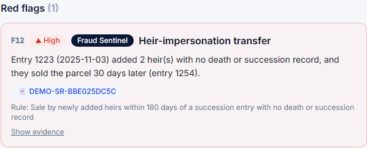
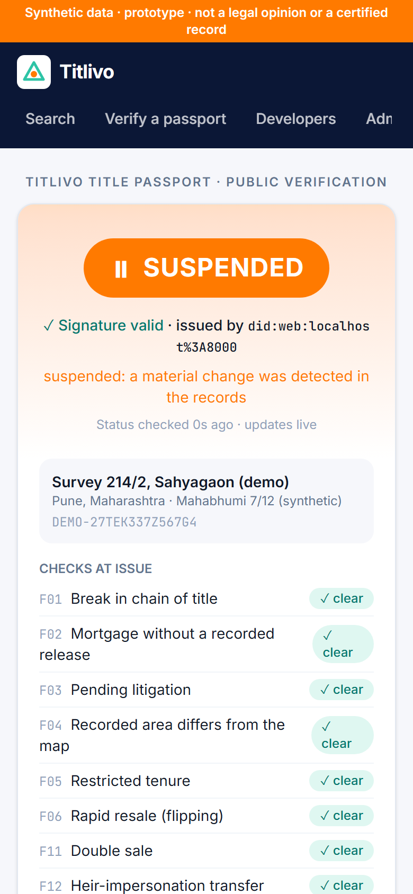
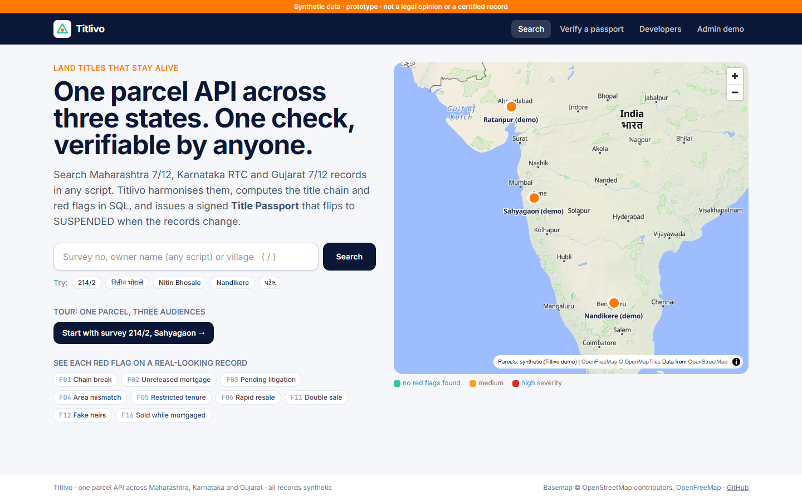
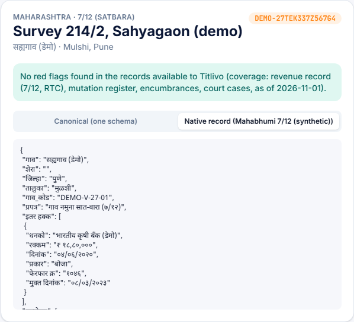
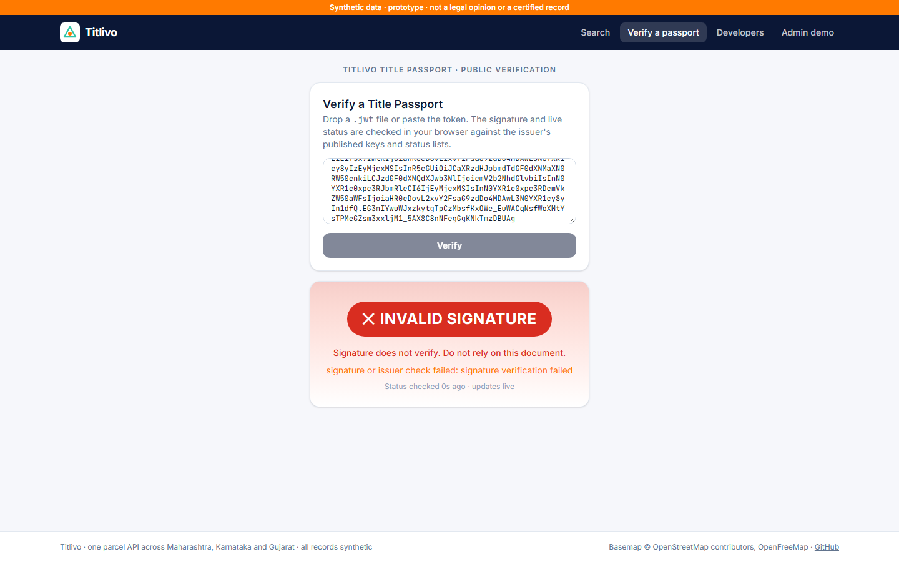
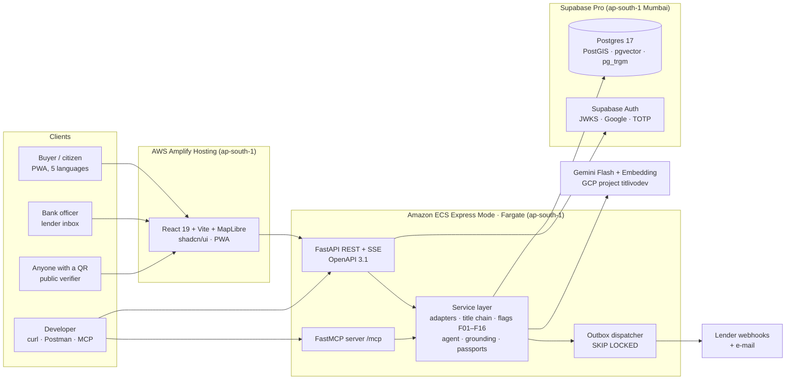

# Titlivo

**A land title that stays alive.** One parcel API across three Indian states, with title chains computed in SQL, cited answers in five languages, and a signed **Title Passport** that flips to SUSPENDED the moment the records show fraud.


---

## See it working

🌐 **Live demo: [main.d2md8dgohc7hhh.amplifyapp.com](https://main.d2md8dgohc7hhh.amplifyapp.com)** · API reference: [/docs](https://titlivo-api.p7gtxt73pr9fe.ap-south-1.cs.amazonlightsail.com/docs) · issuer: [`did.json`](https://titlivo-api.p7gtxt73pr9fe.ap-south-1.cs.amazonlightsail.com/.well-known/did.json)

▶️ **[2½-minute walkthrough (MP4)](https://github.com/Gurjas2112/Titlivo/releases/download/demo-media-v1/full-walkthrough.mp4)** · ▶️ **[Live revocation, split screen (25 s)](https://github.com/Gurjas2112/Titlivo/releases/download/demo-media-v1/live-revocation.mp4)** · [all clips](https://github.com/Gurjas2112/Titlivo/releases/tag/demo-media-v1) · [33 screenshots](demo-media/screenshots)

| A fake-heir sale reaches the registry… | …and the passport a bank scanned flips to SUSPENDED |
|---|---|
|  |  |

| One search, any script | The record exactly as Maharashtra writes it | Tamper with one field → signature fails |
|---|---|---|
|  |  |  |

What works today (all on synthetic data, verified by tests):

- **270 parcels in 6 demo villages across MH, KA and GJ**, generated as native records in Marathi, Kannada and Gujarati with each state's units (hectare-are, acre-gunta, hectare-are-sq m) and date formats, then harmonised by YAML-driven adapters into one schema. The native record is always returned too.
- **Title chain and 9 red-flag rules in SQL** (chain break, unreleased mortgage, litigation, area mismatch, restricted tenure, flipping, and the Fraud Sentinel patterns double sale, fake heirs, sale while mortgaged). Graded against 72 planted defects: **100 % recall and 100 % precision**.
- **Title Passport**: a W3C Verifiable Credential (`vc+jwt`, Ed25519, `did:web`) with no names inside, Bitstring Status Lists for live status, verified **in the browser** against published keys. Injecting a registry event re-runs the rules and suspends passports **in one transaction**; open verifiers update in seconds.
- **REST API** (search in any script, dossier, title chain, flags; masked names for anonymous callers; RFC 9457 errors; `X-Coverage` header; Scalar docs), **MCP server** for AI agents, **Postman collection** (23 assertions passing), **5 storytelling SQL queries**.

---

## Contents

- [See it working](#see-it-working)
- [Why I built this for Landeed](#why-i-built-this-for-landeed)
- [The problem](#the-problem)
- [What Titlivo does](#what-titlivo-does)
- [The differentiator: Title Passport](#the-differentiator-title-passport)
- [Architecture](#architecture)
- [Tech stack](#tech-stack)
- [Environments](#environments)
- [API in 60 seconds](#api-in-60-seconds)
- [Three-minute demo](#three-minute-demo)
- [Design rules](#design-rules)
- [Milestones](#milestones)
- [Quickstart (local)](#quickstart-local)
- [Production deployment](#production-deployment)
- [Documentation](#documentation)
- [Data, licences and disclaimer](#data-licences-and-disclaimer)

---

## Why I built this for Landeed

Landeed sells "property records from every state through one integration", an API and MCP for enterprises, and Terra, which answers questions about ownership in plain language. A solutions engineer at Landeed has to **show** that to a bank, a developer and a buyer, often in the same meeting. Titlivo is a working model of that job: one parcel, three audiences, every claim traceable to a record.

| What the JD asks for | Where Titlivo shows it |
|---|---|
| **Build and maintain demo environments and prototypes** for enterprise use cases | Three environments (local, staging, production on AWS Mumbai); a one-click "Tour: one parcel, three audiences"; a lender inbox and an admin "inject registry event" panel built for live demos |
| **Run live API demos** for technical and non-technical people | The same parcel shown as a buyer (chat in Marathi), a bank officer (title draft PDF + passport) and a developer (`curl` + MCP Inspector) |
| **Technical documentation**: integration guides, API walkthroughs, how-tos | [Engineering specification v2.1](docs/03_Titlivo_Engineering_Specification_v2.1.md) (~2,000 lines); planned `quickstart.md`, `integrate-lender.md` ("integrate with your loan system in a day"), `mcp.md`, passport verification guide, error catalogue, ADRs |
| **Python**: hands-on | FastAPI service, state adapters, transliteration, Pydantic AI agent, FastMCP server, synthetic data generator, outbox dispatcher |
| **SQL**: pull, filter and present data | Title chain as a recursive CTE; 16 red-flag rules as SQL files; `sql/demo/*.sql`, 10 storytelling queries ("parcels with an unreleased mortgage and ≥ 2 transfers in 3 years") |
| **REST APIs**: requests and responses, Postman, curl, reading API docs | OpenAPI 3.1 with Scalar docs, RFC 9457 errors, ETags, SSE; a public **Postman** workspace with tests; a "Show API call" panel on every dossier |
| **Explain technical ideas to non-technical audiences** | Plain-language flag cards, a cited Q&A agent, a 3-minute demo script, a chaptered walkthrough and a story film |
| **Detail-oriented, documents work** | Every requirement traced to a test; a 65-item demo coverage matrix that fails the build if any feature is missing from the demo media |
| *Nice to have:* Jupyter, GitHub, BI/data visualisation, small internal tools | 3 Jupyter notebooks (bank officer story, SQL insights, verify a passport); GitHub Actions CI with OIDC deploy; Grafana dashboards; bulk CSV lookup |
| *Nice to have:* storytelling with data | Coverage map, flag distribution by state, a "what a bank sees" narrative |

How it lines up with Landeed's product:

| Landeed today | Titlivo equivalent |
|---|---|
| One integration for records from every state | One canonical API across Maharashtra, Karnataka and Gujarat |
| `GET /v1/parcels/{survey}` with owner, litigation and encumbrances | `GET /v1/parcels/{id}` dossier with title chain and red flags |
| Terra: ask in Indian languages, trace ownership | "Ask the Property" agent: answers in en/hi/mr/kn/gu, every fact cited |
| Terra MCP for AI agents | FastMCP server with six read-only tools |
| 30-year chain of title for banks | Deterministic title chain + title draft PDF + verifiable Title Passport |

---

## The problem

"Land is a State subject." Every state keeps records in its own format, units, language and vocabulary:

- Maharashtra issues a **7/12** in *hectare-are*, with *भोगवटादार वर्ग* tenure classes.
- Karnataka issues an **RTC (Pahani)** in *acre-gunta*.
- Gujarat's **7/12 and 8-A** use *hectare-are-sq m*.
- A *khasra* in one state is a *survey number* in another and a *dag* in a third.

On top of that, **title diligence is disposable**. A buyer, the buyer's bank, a balance-transfer lender and an insurer each re-run the same search on the same parcel, and the PDF is out of date the day it's printed. Fraud happens *after* the check. In March 2026, Keesara police (Hyderabad) arrested five people who used forged death certificates and fake heirs to re-register other people's plots.

---

## What Titlivo does

1. **Harmonise.** State adapters driven by YAML field maps convert native records into one canonical schema, aligned to DoLR's Glossary of Revenue Terms and keyed by LGD codes and a demo ULPIN. Geometry lives in PostGIS, and the native record is always returned next to the canonical one.
2. **Reason in SQL.** A recursive CTE builds the chain of title. **16 rules** find red flags:
   - **F01–F10, record checks:** chain break, unreleased mortgage, pending litigation, area mismatch, Class-II tenure, rapid flips, uncertified mutation, NA conversion, government land, name mismatch.
   - **F11–F16, Fraud Sentinel cross-source rules:** double sale, heir-impersonation transfer, registration–revenue mismatch, GPA chain, dormant-parcel activation, sale while mortgaged.
3. **Explain with citations.** A Pydantic AI agent on Gemini answers plain-language questions ("Is there a loan on this land?") using only tool output and a cited land-law knowledge base. The knowledge base covers the Registration Act, the Transfer of Property Act and the state codes, searched with hybrid pgvector + full-text search and rank fusion. A validator rejects any number, date or name that isn't in the tool output.
4. **Serve integrators and agents.** A versioned REST API, PostGIS vector map tiles, bulk CSV lookup and an **MCP server**, so any MCP-capable AI agent can query parcels.

## The differentiator: Title Passport

A title check becomes a **signed, machine-verifiable credential**: a W3C Verifiable Credential 2.0, `vc+jwt`, EdDSA, issuer `did:web`.

- **Issued once, verified by anyone** by QR, link or API, in seconds, without an account.
- **Live status.** A W3C Bitstring Status List flips it to **SUSPENDED** automatically when monitoring sees a material change: a new transfer, a new charge, a court case, or a Fraud Sentinel pattern.
- **Privacy by design.** The passport contains no names, only an owner count plus a salted commitment, check results with evidence digests, coverage and validity.
- **Owner-controlled sharing.** An owner can grant a lender access to the full dossier, limited in time and purpose, with consent receipts. The lender subscribes to signed status webhooks (Standard Webhooks).
- **Exactly-once delivery.** A material change commits the new event, the re-evaluated flags, the status-bit change and the notifications in **one Postgres transaction**. An outbox dispatcher (`FOR UPDATE SKIP LOCKED`) then delivers them. There's no Redis and no Kafka.

In my research I found no product in India that packages multi-source title diligence as a portable credential with live revocation.

---

## Architecture



Every surface (REST, agent tools and MCP) calls **the same service functions**, and tests prove parity, including name masking for anonymous callers.

---

## Tech stack

| Layer | Choice |
|---|---|
| API | Python 3.12, FastAPI, Pydantic v2 (strict), `sse-starlette`, Scalar docs, RFC 9457 errors |
| Database | Supabase Postgres 17 + PostGIS + pgvector + pg_trgm; **hand-written SQL** (no ORM); psycopg 3 |
| Geo | Shapely 2, GeoPandas, pyproj, PostGIS `ST_AsMVT` vector tiles, MapLibre GL JS + OpenFreeMap |
| Harmonisation | YAML field maps, `indic-transliteration` (ISO 15919), `rapidfuzz`, unit converters with property tests |
| AI | Pydantic AI + Gemini Flash (temperature 0, structured output), Gemini Embedding (768-d), Docling on GPU for ingest, hybrid RAG with reciprocal-rank fusion |
| Agents | FastMCP 3 (streamable HTTP), API-key bearer auth with scopes |
| Credentials | W3C VC 2.0, VC-JOSE-COSE, Bitstring Status List v1.0, `joserfc` (server) + `jose` (browser), shared test vectors |
| Frontend | React 19, Vite, TypeScript strict, Tailwind v4, shadcn/ui, TanStack Query, installable PWA |
| Auth | Supabase Auth: publishable/secret keys, asymmetric JWTs verified via JWKS, Google sign-in, TOTP for staff, RLS |
| Quality | pytest, Hypothesis, Playwright, Vitest, Locust, **promptfoo** (RAG, agent, red team), ruff, mypy strict, `gitleaks` |
| Observability | OpenTelemetry → Grafana (`otel-lgtm` locally, Grafana Cloud in production), LLM token, cost and grounding metrics |
| Production | ECR → ECS Express Mode, Amplify Hosting, Secrets Manager, GitHub Actions OIDC, CloudWatch |

## Environments

| | Local | Staging | Production |
|---|---|---|---|
| API / web | Laptop (WSL2) | Laptop with staging config | ECS Express + Amplify, **Mumbai** |
| Database + Auth | Supabase CLI | Supabase free project (Sydney) | Supabase Pro, **Mumbai** |
| E-mail | Mailpit | Mailpit | Resend |
| Secrets | `.env` (git-ignored) | `.env.staging` (git-ignored) | AWS Secrets Manager |

Details: [spec §15.0](docs/03_Titlivo_Engineering_Specification_v2.1.md#150-environments).

---

## API in 60 seconds

```bash
API=http://localhost:8000

# Search in any script; names are masked for anonymous callers
curl -s "$API/v1/parcels/search?q=214/2"
curl -s "$API/v1/parcels/search" -G --data-urlencode "q=नितीन भोसले"

# Full dossier: canonical + native record, title chain, flags, coverage
curl -s "$API/v1/parcels/DEMO-27TEK337Z567G4" -H "Authorization: Bearer $TITLIVO_KEY"

# Red flags only, each with evidence and the source record id
curl -s "$API/v1/parcels/DEMO-27TEK337Z567G4/flags"

# Issue a Title Passport, then verify it (no account needed to verify)
curl -s -X POST "$API/v1/parcels/DEMO-27TEK337Z567G4/passports"
curl -s -X POST "$API/v1/passports/verify" -H "Content-Type: application/json" -d '{"jwt":"<token>"}'
# → {"status":"LIVE","signature":"valid","issuer":"did:web:…", …}

# Live status list and issuer keys
curl -s "$API/status/1"
curl -s "$API/.well-known/did.json"
```

MCP: `npx @modelcontextprotocol/inspector`, transport *Streamable HTTP*, URL `$API/mcp/`, header `Authorization: Bearer $TITLIVO_KEY`. Tools today: `search_parcels`, `get_parcel_dossier`, `get_title_chain` and `list_red_flags` (`explain_term` and `search_land_law` arrive with the knowledge base). Or run `uv run --directory api python -m titlivo.tools.mcp_demo`.

Every response carries an `X-Coverage` header. The full endpoint list is in [spec Annexure A](docs/03_Titlivo_Engineering_Specification_v2.1.md#annexure-a-api-reference-summary).

---

## Three-minute demo

"A title check that stays alive":

1. **0:00**: Every bank re-runs title checks on the same land, and the report is stale the day it's printed.
2. **0:20**: Search a Maharashtra parcel. The dossier shows red flags in plain language. Ask in Marathi, "Is there a loan on this land?", and get a cited answer.
3. **0:55**: **Issue a Title Passport.** Scan the QR with a phone: **LIVE, signature valid**. No login needed.
4. **1:20**: **Share with a lender** (purpose: home loan, 7 days). It appears in the lender inbox.
5. **1:40**: Admin panel: inject "sale by newly added heirs". Fraud Sentinel raises **F12**, the phone flips to **SUSPENDED** within seconds, and the lender's webhook arrives.
6. **2:15**: Developer view: `curl`, then MCP Inspector → `list_red_flags`. A Karnataka parcel returns the same JSON shape.
7. **2:40**: Diligence done once, verifiable by anyone, and alive.

Steps 4 (lender sharing) and the lender webhook are on the roadmap; everything else above runs today. The full runbook, including how to reset between runs, is in [docs/runbooks/demo.md](docs/runbooks/demo.md).

The demo media is generated from the running app by Playwright, never hand-edited (`npm run demo:shots`, `demo:record`, `demo:mp4`, `demo:verify`):

- 33 flow-wise screenshots at laptop and phone sizes, with captions in `demo-media/manifest.json`;
- a chaptered walkthrough, a split-screen live-revocation clip and one clip per chapter;
- a check that rejects blank or duplicate screenshots.

---

## Design rules

1. **Facts come from SQL, never from the model.** The LLM phrases; it never computes owners, dates, amounts or flags.
2. **Grounded or not sent.** Every number, date and name in an answer must appear in that turn's tool output. Otherwise the agent retries once, then falls back to a template.
3. **Cite everything.** Record facts cite the source record ID; legal statements cite act, section and a verbatim quote.
4. **Never "safe".** Titlivo says "No red flags found in the records available to Titlivo (coverage: …)". Reports are drafts for an advocate, not legal opinions.
5. **Mask by default.** Anonymous callers get masked names on every surface: REST, UI, MCP and agent tools.
6. **Untrusted text is data.** Free text from records is quoted, never followed: a prompt-injection red team runs in CI.
7. **Synthetic only.** No real people, records or government logos.

---

## Milestones

| # | Milestone | Status |
|---|---|---|
| — | Engineering specification v2.1 (production-ready, mapped to provisioned accounts) | ✅ Done |
| M0 | Scaffold, Makefile, CI (ruff, pytest, defect gate, gitleaks), `/healthz` | ✅ Done |
| M1 | Migrations, synthetic generator with planted defects (6 demo villages, 270 parcels) | ✅ Done · real datameet village polygons next |
| M2 | Units, transliteration, glossary, three state adapters | ✅ Done |
| M3 | Title chain SQL + flags + defect gate (100 % recall, 100 % precision) | ✅ F01–F06 · F07–F10 next |
| M4 | Masking, REST parcels endpoints, problem+json, coverage header | ✅ Demo API keys · Supabase Auth sign-in next |
| M5 | Vector tiles (p95 < 150 ms) | GeoJSON layer today · MVT next |
| M6 | Web: search, map, dossier, timeline, flags, Show API call | ✅ Done · glossary page next |
| M7 | Land-law knowledge base + hybrid search (≥ 90 % section hit) | Planned |
| M8 | Cited agent + grounding validator | ✅ Grounding check + template fallback · Gemini key, SSE streaming, evals next |
| M9 | MCP server (4 tools, key auth) | ✅ Done |
| M10 | Title draft PDF + bulk lookup | Planned |
| M11 | Red team, admin console, telemetry | Admin demo panel done · rest planned |
| M13 | Title Passport (signing, status lists, Python + browser verifiers, QR, verifier page) | ✅ Done |
| M14 | Fraud Sentinel + live monitoring + suspension in one transaction | ✅ F11, F12, F16 · F13–F15, outbox webhooks, share grants, lender inbox next |
| M15a | Staging on Supabase cloud + secret scanning | gitleaks in CI ✅ · staging next |
| M15b | Production deploy (AWS Mumbai, lowest-cost: Lightsail container + Amplify + Supabase; secrets in SSM; root keys removed; SSO + MFA) | ✅ Live · database moves to Mumbai next |
| M12 | Docs, Postman collection, Jupyter notebooks | ✅ Postman (23 assertions) · notebooks next |
| M16 | Demo media: screenshots, walkthrough, clips | ✅ 33 screenshots, 3 videos · 65-item coverage next |
| M17 | Story film | Planned |

---

## Quickstart (local)

Requirements: Docker, [`uv`](https://docs.astral.sh/uv/), Node 22+. Works on Windows (Git Bash), macOS, Linux and WSL.

```bash
git clone https://github.com/Gurjas2112/Titlivo.git && cd Titlivo
cp .env.example .env
make db          # PostGIS on :54329
make keys        # Ed25519 passport signing key + demo API keys → .env (git-ignored)
make data        # generate synthetic records → migrate → ingest → defect gate
make test        # 28 tests
make api         # API on :8000  (docs at /docs, MCP at /mcp/)
cd web && npm install && npm run dev   # web on :5173
```

Your developer key (`DEMO_API_KEY`) and admin key (`ADMIN_API_KEY`) are in `.env`. The admin key unlocks the "Admin demo" page. Step-by-step set-up for the full system: [spec §12.3](docs/03_Titlivo_Engineering_Specification_v2.1.md#123-installation-gated).

## Production deployment

The production target is AWS Mumbai (ap-south-1):

- **ECS Express Mode** (Fargate, autoscaling 1–3 tasks, HTTPS load balancer) for the API;
- **Amplify Hosting** for the web app;
- **Supabase Pro** in Mumbai, so data stays in India;
- **Secrets Manager** for every secret;
- deploys from **GitHub Actions** using OIDC, so no long-lived AWS keys exist.

The runbook separates account-owner actions (H1–H9) from commands a coding agent can run, and ends with a go-live checklist. See [spec §15.2–15.3](docs/03_Titlivo_Engineering_Specification_v2.1.md#152-production-deployment-on-aws-mumbai-live-link).

---

## Documentation

| Document | What it covers |
|---|---|
| [Engineering specification v2.1](docs/03_Titlivo_Engineering_Specification_v2.1.md) | **Current baseline**: requirements, architecture, data model, security, environments, AWS runbook, test strategy, demo plan, 65-item coverage matrix |
| [Engineering specification v2.0](docs/02_Titlivo_Engineering_Specification_v2.0.md) | Previous baseline, kept for history |

| [Demo runbook](docs/runbooks/demo.md) | How to run, present and reset the 3-minute demo |
| [Postman collection](postman/) | 18 requests with tests, local environment |
| [Storytelling SQL](sql/demo/) | 5 queries a lender, buyer or analyst would ask |
| [ADR-0001](docs/adr/0001-ed25519-algorithm-name.md) | Why the passport header says `Ed25519` rather than `EdDSA` |

Planned with the build: `docs/mcp.md`, `docs/integrate-lender.md`, `docs/security-faq.md`, `docs/model-card.md` and `notebooks/`.

## Data, licences and disclaimer

- **All parcel, owner and transaction data is synthetic.** IDs start with `DEMO-`, and every record carries `synthetic: true`.
- The six villages and their parcel boundaries are generated (fictional villages at plausible locations, marked "demo"). Real village boundaries from datameet (ODbL) are on the roadmap. Basemap © OpenStreetMap contributors, OpenFreeMap.
- Titlivo is a prototype. A Title Passport attests only to the records Titlivo has seen. It is **not** a guarantee, a certificate of title, a legal digital signature or a legal opinion.
- Code is under the [MIT License](LICENSE).

---

**Author:** Gurjas Gandhi, [github.com/Gurjas2112](https://github.com/Gurjas2112)
