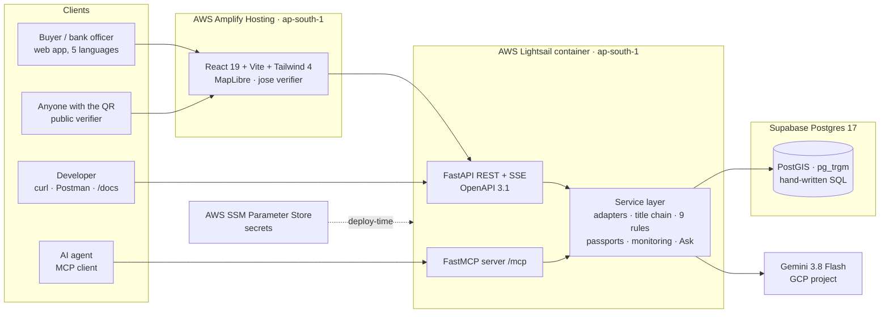

# Titlivo

**A land title that stays alive.** One parcel API across three Indian states, with title chains and fraud checks computed in SQL, grounded answers in five languages, and a signed **Title Passport** that flips to SUSPENDED the moment the records change.


---

## See it working

🌐 **Live demo: [main.d2md8dgohc7hhh.amplifyapp.com](https://main.d2md8dgohc7hhh.amplifyapp.com)** · API reference: [/docs](https://titlivo-api.p7gtxt73pr9fe.ap-south-1.cs.amazonlightsail.com/docs) · issuer keys: [`did.json`](https://titlivo-api.p7gtxt73pr9fe.ap-south-1.cs.amazonlightsail.com/.well-known/did.json)

▶️ **[2½-minute walkthrough (MP4)](https://github.com/Gurjas2112/Titlivo/releases/download/demo-media-v1/full-walkthrough.mp4)** · ▶️ **[Live revocation, split screen (25 s)](https://github.com/Gurjas2112/Titlivo/releases/download/demo-media-v1/live-revocation.mp4)** · [all clips](https://github.com/Gurjas2112/Titlivo/releases/tag/demo-media-v1) · [33 screenshots](demo-media/screenshots)

| A fake-heir sale reaches the registry… | …and the passport a bank scanned flips to SUSPENDED |
|---|---|
|  |  |

| One search, any script | The record exactly as Maharashtra writes it | Tamper with one field → signature fails |
|---|---|---|
|  |  |  |

---

## Highlights

Every number below can be checked in this repo or on the live site.

| | |
|---|---|
| 🗺️ **3 states, 3 record formats, 1 schema** | 270 parcels in 6 demo villages: Maharashtra 7/12 (Marathi, Devanagari numerals, hectare-are), Karnataka RTC (Kannada, acre-gunta), Gujarat 7/12 + 8-A (Gujarati, hectare-are-sq m), harmonised by YAML-driven adapters with **zero unknown terms** |
| 🔎 **9 SQL rules, 100 % recall, 100 % precision** | Chain of title as a recursive CTE, 6 record checks and 3 Fraud Sentinel patterns (double sale, fake heirs, sale while mortgaged), graded in CI against **72 planted defects** |
| 🛂 **Title Passport, verifiable by anyone** | W3C Verifiable Credential 2.0 (`vc+jwt`, Ed25519, `did:web`), **no names inside**, live status from Bitstring Status Lists, verified **in the browser** against published keys; a tampered passport fails |
| ⚡ **Live revocation in one transaction** | A registry event re-runs every rule, flips the passport's status bit and records the change **atomically**; open verifier pages update over SSE within seconds |
| 🗣️ **Grounded answers in 5 languages** | Gemini 3.8 Flash answers in English, Hindi, Marathi, Kannada and Gujarati; **every number is checked against the records** before it is shown, "safe" and "legal opinion" claims are rejected and retried; a prompt-injection attempt is caught |
| 🤖 **Built for AI agents too** | An MCP server (Streamable HTTP, key auth) exposes the same service layer as the REST API, with the same name masking |
| ☁️ **Production on AWS for ≈ US$11/month** | Lightsail container + Amplify + Supabase, secrets in SSM Parameter Store, SSO with MFA, no root keys, budget and anomaly alerts, one-command deploy |
| 🚀 **Fast where it matters** | Dossier in ≈ 1.1 s across regions (from 7.7 s) through single-round-trip reads and parallel queries; data load in 4 s with pipelined inserts |
| ✅ **Quality gates** | 29 tests, ruff, CI with secret scanning (gitleaks) and the defect gate, a Postman collection with 23 passing assertions, Playwright-captured screenshots with a blank-image check |
| 📚 **Researched** | A ~2,000-line engineering specification, an ADR, a demo runbook and [44 annotated sources](docs/references.md) on land litigation, titling policy, DILRMP 3.0, Land Stack and 2026 fraud cases |

---

## Contents

- [See it working](#see-it-working) · [Highlights](#highlights)
- [The problem](#the-problem) · [What Titlivo does](#what-titlivo-does) · [The Title Passport](#the-title-passport)
- [Architecture](#architecture) · [Tech stack](#tech-stack) · [API in 60 seconds](#api-in-60-seconds)
- [Three-minute demo](#three-minute-demo) · [Design rules](#design-rules)
- [Built](#built) · [Next](#next)
- [Quickstart](#quickstart-local) · [Production](#production-deployment) · [Documentation](#documentation) · [References](#references)

---

## The problem

"Land is a State subject." Every state keeps records in its own format, units, language and vocabulary:

- Maharashtra issues a **7/12** in *hectare-are*, with *भोगवटादार वर्ग* tenure classes.
- Karnataka issues an **RTC (Pahani)** in *acre-gunta*.
- Gujarat's **7/12 and 8-A** use *hectare-are-sq m*.
- The same document is a *Jamabandi* in Haryana, a *RoR* in Maharashtra and a *Pahani* in Karnataka.

On top of that, **title diligence is disposable**. A buyer, the buyer's bank, a balance-transfer lender and an insurer each re-run the same search on the same parcel, and the PDF is out of date the day it's printed. Fraud happens *after* the check: in March 2026, Keesara police (Hyderabad) arrested five people who used forged death certificates and fake heirs to re-register other people's plots. [More on the problem →](docs/references.md)

---

## What Titlivo does

1. **Harmonise.** State adapters driven by YAML field maps turn native records into one canonical schema, with a glossary of each state's own terms (aligned in spirit with DoLR's Glossary of Revenue Terms). Units, scripts, numerals and date formats are normalised; geometry lives in PostGIS, and the native record is always returned next to the canonical one.
2. **Reason in SQL.** A recursive CTE walks the chain of title and checks every transfer against the holders recorded at the time. Nine rules raise red flags, each with plain-language text built only from its evidence and the source record id:
   - **Record checks:** F01 chain break · F02 unreleased mortgage · F03 pending litigation · F04 recorded vs mapped area · F05 restricted tenure · F06 rapid resale.
   - **Fraud Sentinel:** F11 double sale · F12 heir-impersonation transfer · F16 sale while mortgaged.
3. **Explain, grounded.** "Ask the property" sends the parcel's SQL facts to Gemini with strict rules, then checks the answer: every number must exist in the records, and "safe", "clear title", "guaranteed" or "legal opinion" claims are rejected. One retry, then a template answer built straight from the facts.
4. **Serve people, integrators and agents.** A web app for buyers and bank officers, a versioned REST API with OpenAPI docs and Postman tests for developers, and an MCP server for AI agents, all on one service layer.

## The Title Passport

A title check becomes a **signed, machine-verifiable credential**.

- **Issued once, verified by anyone** by QR, link or API, in seconds, without an account. The browser checks the Ed25519 signature against the issuer's published `did.json`.
- **Live status.** A W3C Bitstring Status List (131,072 entries in 16 KB) flips it to **SUSPENDED** when a material change appears in the records: a new transfer, a new charge, a court case or a Fraud Sentinel pattern.
- **Privacy by design.** No names inside: an owner count plus a salted commitment, the result of every rule with a digest of its evidence, coverage, validity and a disclaimer.
- **One transaction.** The new event, the re-evaluated flags, the status-bit change and the audit row commit together; notifications go out only after the commit.

---

## Architecture



REST, MCP and the Ask feature call **the same service functions**, and tests check that anonymous callers get masked names everywhere.

---

## Tech stack

| Layer | In use |
|---|---|
| API | Python 3.12, FastAPI, Pydantic v2, `sse-starlette`, Scalar docs, RFC 9457 errors, `X-Coverage` header |
| Database | PostgreSQL 17 + PostGIS + pg_trgm (Supabase in production, Docker locally); **hand-written SQL files**, psycopg 3 with pipelining |
| Harmonisation | YAML field maps, `indic-transliteration` (ISO 15919), unit converters for hectare-are, acre-gunta and hectare-are-sq m |
| Credentials | W3C VC 2.0 as `vc+jwt`, Ed25519 (`joserfc` on the server, `jose` in the browser), `did:web`, Bitstring Status List v1.0, QR codes |
| AI | Gemini 3.8 Flash (`google-genai`), temperature 0, low thinking level, grounding validator with retry and template fallback |
| Agents | FastMCP (Streamable HTTP), bearer-key auth with scopes |
| Frontend | React 19, Vite, TypeScript, Tailwind CSS 4, MapLibre GL + OpenFreeMap, React Router |
| Quality | pytest, ruff, Playwright (screenshots and recordings), newman (Postman), GitHub Actions, gitleaks |
| Production | AWS Lightsail containers, Amplify Hosting, SSM Parameter Store, IAM Identity Center (SSO + MFA), AWS Budgets |

---

## API in 60 seconds

```bash
API=https://titlivo-api.p7gtxt73pr9fe.ap-south-1.cs.amazonlightsail.com   # or http://localhost:8000

# Search in any script; names are masked for anonymous callers
curl -s "$API/v1/parcels/search?q=214/2"
curl -s "$API/v1/parcels/search" -G --data-urlencode "q=नितीन भोसले"

# Full dossier: canonical + native record, title chain, flags, coverage
curl -s "$API/v1/parcels/DEMO-27TEK337Z567G4"

# Red flags only, each with evidence and the source record id
curl -s "$API/v1/parcels/DEMO-27TEK337Z567G4/flags"

# Ask in Marathi; the answer is checked against the records before it is returned
curl -s -X POST "$API/v1/ask" -H "Content-Type: application/json" \
  -d '{"parcel_id":"DEMO-27TEK337Z567G4","language":"mr","question":"या जमिनीवर कर्ज आहे का?"}'

# Issue a Title Passport, then verify it (no account needed)
curl -s -X POST "$API/v1/parcels/DEMO-27TEK337Z567G4/passports"
curl -s -X POST "$API/v1/passports/verify" -H "Content-Type: application/json" -d '{"jwt":"<token>"}'
# → {"status":"LIVE","signature":"valid","issuer":"did:web:…", …}

# Live status list and issuer keys
curl -s "$API/status/1"
curl -s "$API/.well-known/did.json"
```

**MCP:** `npx @modelcontextprotocol/inspector`, transport *Streamable HTTP*, URL `$API/mcp/`, header `Authorization: Bearer <key>`. Tools: `search_parcels`, `get_parcel_dossier`, `get_title_chain`, `list_red_flags`. Or run `uv run --directory api python -m titlivo.tools.mcp_demo`.

**Postman:** import [`postman/titlivo.postman_collection.json`](postman/): 18 requests, 23 assertions, including the full issue → suspend → reset sequence.

---

## Three-minute demo

"A title check that stays alive" ([full runbook](docs/runbooks/demo.md)):

1. **0:00** Every bank re-runs title checks on the same land, and the report is stale the day it's printed.
2. **0:20** Search in Marathi or by survey number. The dossier shows the record as the state wrote it, next to one clean schema.
3. **0:50** Red flags in plain language: the fake-heir pattern caught on another parcel, with evidence and source.
4. **1:10** Ask in Marathi, "Is there a loan on this land?": a grounded, cited answer.
5. **1:25** **Issue a Title Passport.** Scan the QR: **LIVE, signature valid**. No login.
6. **1:45** Inject a fake-heir sale into the registry. The verifier flips to **SUSPENDED** within seconds.
7. **2:10** Edit one character of the passport: **INVALID SIGNATURE**.
8. **2:25** Developers: `curl`, the API docs, and an AI agent calling the MCP server.

---

## Design rules

1. **Facts come from SQL, never from the model.** The model phrases; it never computes owners, dates, amounts or flags.
2. **Grounded or not sent.** Every number in an answer must appear in that turn's facts; otherwise one retry, then a template answer.
3. **Cite the source.** Every flag carries its evidence and the source record id; answers cite entry (mutation) numbers.
4. **Never "safe".** Titlivo says "No red flags found in the records available to Titlivo (coverage: …)". Passports say they are not a guarantee or a legal opinion.
5. **Mask by default.** Anonymous callers get masked names on every surface: REST, web, MCP and Ask.
6. **Untrusted text is data.** Record remarks (some contain planted injection strings) are passed as quoted data, never as instructions.
7. **Synthetic only.** No real people, records or government logos.

---

## Built

- **Data and harmonisation:** synthetic generator (6 villages, 270 parcels, 30-year histories, 72 planted defects), 3 state adapters, glossary, unit and numeral normalisation, cross-script name search.
- **Reasoning:** title-chain CTE, 9 red-flag rules, defect gate in CI (100 % recall and precision).
- **REST API:** search, dossier (canonical + native), title chain, flags, map layer, coverage, glossary, Ask, passports, status lists, DID document, SSE streams, admin event injection and reset.
- **Title Passport:** signing, status lists, Python and browser verifiers, QR, public mobile verifier, `.jwt` download, tamper detection.
- **Live monitoring:** registry-event injection (fake heirs, double sale, new mortgage, court case), atomic re-evaluation and suspension, live verifier updates, demo reset.
- **Ask the property:** Gemini 3.8 Flash in 5 languages with a grounding validator, banned-claim check, retry and template fallback.
- **MCP server:** 4 tools with key auth and masking, plus a demo client.
- **Web app:** search, map with severity colours, dossier with timeline and flag evidence, native vs canonical view, "Show API call", passport card, verifier, developer and admin pages, answer-language picker.
- **Production:** live on AWS Mumbai (Lightsail + Amplify) with Supabase; secrets in SSM; SSO + MFA; root keys removed; budget alerts; one-command deploy script.
- **Proof and docs:** 29 tests, CI (lint, tests, defect gate, secret scan), Postman collection, 5 storytelling SQL queries, 33 screenshots, 3 videos plus chapter clips, demo runbook, ADR, two engineering specs, 44-source reference list.

## Next

Designed in the [engineering specification](docs/03_Titlivo_Engineering_Specification_v2.1.md) and planned in this order:

1. **Land-law knowledge base:** acts and state revenue codes ingested with Docling, hybrid vector + full-text search, cited law answers, two more MCP tools (spec §6.4).
2. **Title-draft PDF and bulk lookup:** an advocate-ready draft report and a 200-row CSV check (§6.8, §6.9).
3. **Lender workflow:** owner-controlled share grants with consent receipts, signed status webhooks through a transactional outbox, a lender inbox, and Fraud Sentinel rules F13–F15 (§6.11–6.13).
4. **Accounts:** Supabase sign-in (e-mail, Google), MFA for staff, per-user API keys (§9).
5. **Scale and polish:** vector tiles, real village boundaries, rules F07–F10, streaming answers with a cache, answer evals and a prompt-injection test suite, telemetry dashboards, the database moved to Mumbai.

---

## Quickstart (local)

Requirements: Docker, [`uv`](https://docs.astral.sh/uv/), Node 22+. Works on Windows (Git Bash), macOS, Linux and WSL.

```bash
git clone https://github.com/Gurjas2112/Titlivo.git && cd Titlivo
cp .env.example .env
make db          # PostGIS on :54329
make keys        # Ed25519 passport signing key + demo API keys → .env (git-ignored)
make data        # generate synthetic records → migrate → ingest → defect gate
make test        # 29 tests
make api         # API on :8000  (docs at /docs, MCP at /mcp/)
cd web && npm install && npm run dev   # web on :5173
```

Your developer key (`DEMO_API_KEY`) and admin key (`ADMIN_API_KEY`) are in `.env`; the admin key unlocks the "Admin demo" page. Add `GOOGLE_API_KEY` for Gemini answers; without it, Ask uses template answers built from the SQL facts.

## Production deployment

Lowest-cost production in AWS Mumbai (ap-south-1), about **US$11 a month**:

- **API:** AWS Lightsail container service (`micro`), HTTPS endpoint, health-checked rolling deploys.
- **Web:** AWS Amplify Hosting with SPA routing.
- **Database:** Supabase Postgres (PostGIS, pg_trgm).
- **Secrets:** AWS SSM Parameter Store (`/titlivo/prod/*`), never in Git or images; separate passport keys per environment.
- **Access:** IAM Identity Center with MFA; root access keys deleted; US$15 budget plus cost-anomaly alerts.

One command builds, pushes and deploys everything, then smoke-tests the live URLs:

```bash
AWS_PROFILE=titlivo bash scripts/deploy.sh            # flags: --skip-data --skip-image --skip-web
```

The design for scaling up (ECS Express Mode, Secrets Manager, GitHub OIDC deploys) is in [spec §15](docs/03_Titlivo_Engineering_Specification_v2.1.md#15-deployment-and-operations).

---

## Documentation

| Document | What it covers |
|---|---|
| [Engineering specification v2.1](docs/03_Titlivo_Engineering_Specification_v2.1.md) | Requirements, architecture, data model, security, environments, deployment runbook, test strategy, demo plan |
| [Engineering specification v2.0](docs/02_Titlivo_Engineering_Specification_v2.0.md) | Previous baseline, kept for history |
| [References](docs/references.md) | 44 annotated sources: research, government reports and news on land records, titling and fraud |
| [Demo runbook](docs/runbooks/demo.md) | How to run, present and reset the 3-minute demo |
| [Postman collection](postman/) | 18 requests with tests and a local environment |
| [Storytelling SQL](sql/demo/) | 5 queries a lender, buyer or analyst would ask |
| [ADR-0001](docs/adr/0001-ed25519-algorithm-name.md) | Why the passport header says `Ed25519` rather than `EdDSA` |

## References

The problem in numbers and news: land disputes in Indian courts, presumptive vs conclusive titles, the national Land Stack and DILRMP 3.0, the Glossary of Revenue Terms, and 2026 fake-heir fraud cases. See **[docs/references.md](docs/references.md)**.

## Data, licences and disclaimer

- **All parcel, owner and transaction data is synthetic.** IDs start with `DEMO-`, and every record carries `synthetic: true`.
- The six villages and their parcel boundaries are generated (fictional villages at plausible locations, marked "demo"). Basemap © OpenStreetMap contributors, OpenFreeMap.
- Titlivo is a prototype. A Title Passport attests only to the records Titlivo has seen. It is **not** a guarantee, a certificate of title, a legal digital signature or a legal opinion.
- Code is under the [MIT License](LICENSE).

---

**Author:** Gurjas Gandhi · [github.com/Gurjas2112](https://github.com/Gurjas2112)
